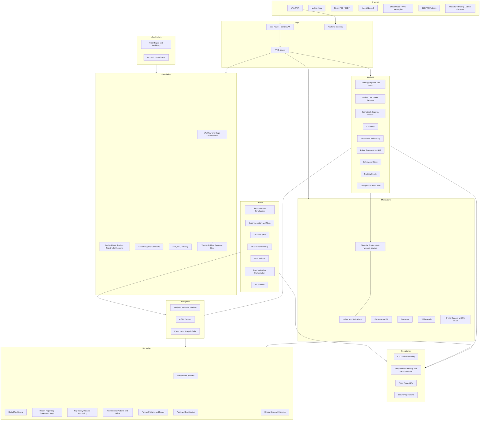

# Project Context — Global Multi-Vertical Gambling Platform

## Problem Statement

Build a platform-agnostic, multi-tenant, multi-region gambling platform covering every gambling vertical, every payment rail, every distribution channel, and every jurisdiction — operating simultaneously as a B2C brand operator and a B2B white-label/API SaaS. Every capability must be independently sellable, metered, billable, monitored, auditable, and reconcilable. Zero hardcoded business policy, zero vendor coupling. Must run end-to-end on a single developer machine with no cloud account, and deploy unchanged to any cloud, hybrid, or on-premise target.

## Requirements

| Area | Requirement |
|------|-------------|
| Verticals | Casino, live dealer, slots, table games, crash/originals, sportsbook, esports, virtuals, exchange, pari-mutuel/racing, poker, tournaments, skill games, lottery, bingo, DFS, sweepstakes/social — infinitely extensible |
| Scale | Enterprise, millions concurrent, zero downtime |
| Tenancy | Multi-tenant, multi-brand, multi-country, multi-region; own brand + white-label + API partners |
| Payments | All fiat rails, all e-wallets, all crypto, multi-currency with conversion |
| Wallets | Multi-wallet with configurable distribution/waterfall, wallet conversion, win routing |
| Money math | Rake, winner calculation, payout strategies, FX, commissions, tax — all pluggable |
| Compliance | All jurisdictions configurable, KYC/AML, responsible gambling, harm detection, audit, certification |
| Channels | Web, mobile apps, retail/land-based, agent networks, SMS/USSD/IVR/messaging |
| Commercial | Everything billable and sellable, entitlements, metering, invoicing, SLA, marketplace |
| Growth | Offers platform, gamification, affiliates, ad platform, SEO, CMS, social, CRM, communications |
| Intelligence | P&L, all analysis domains, AI/ML, forecasting, reporting, statements, reconciliation, logs |
| Principle | Zero hardcoding, all agnostic, with a defined set of safety invariants |

## Architecture (Mermaid)

## Technology Stack

| Concern | Choice | Rationale |
|---------|--------|-----------|
| Core services | Go | Latency, concurrency, operational simplicity, hiring pool |
| Game math, RNG, fairness | Rust (native + WASM) | Determinism, memory safety, identical client/server verification |
| Exchange & tote matching | Rust, single-writer per market | Deterministic ordering, predictable tail latency |
| Realtime fan-out | Elixir / Phoenix | Proven millions of persistent connections |
| Durable execution | Temporal (or equivalent, behind a port) | Sagas, compensation, exactly-once scheduling |
| Web | Next.js + TypeScript | SSR/ISR for SEO, per-tenant theming |
| Mobile | React Native | Shared domain logic with web |
| Consoles | React + dense data-grid UI kit | Operational tables and dashboards |
| OLTP | PostgreSQL + Citus | ACID, tenant partitioning, mature tooling |
| Cache / leaderboards | Redis Cluster | Latency, sorted sets |
| Event backbone | Kafka (prod) / NATS JetStream (local) | Durable audit stream, replay |
| Analytics | ClickHouse | Billions of events, sub-second aggregation |
| Search / logs | OpenSearch | Vendor-neutral |
| Secrets / keys | Vault + PKCS#11 | Rotation, HSM-ready for RNG and custody |
| Custody | MPC/HSM behind a port | Crypto hot/warm/cold segregation |
| Orchestration | Kubernetes; k3s locally | Cloud-agnostic by construction |
| Local dev | Docker Compose + MinIO + MailHog + mock vendors | No cloud account required |
| CI/CD | GitHub Actions + Argo CD + Helm | GitOps, reproducible environments |
| Observability | Prometheus, Grafana, Loki, Tempo | Portable, no lock-in |
